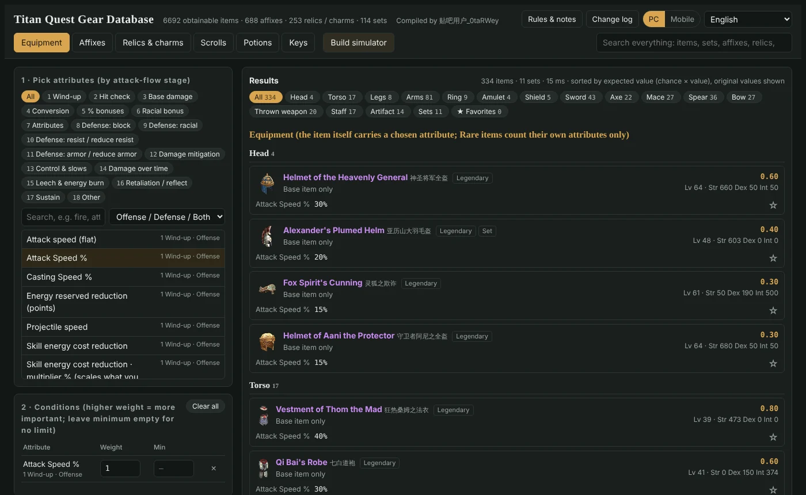
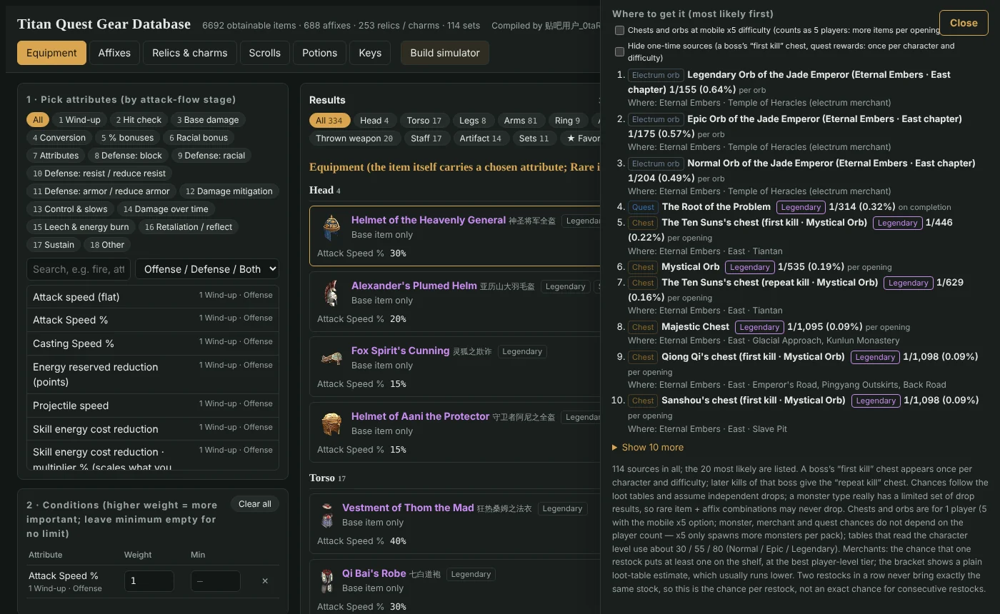
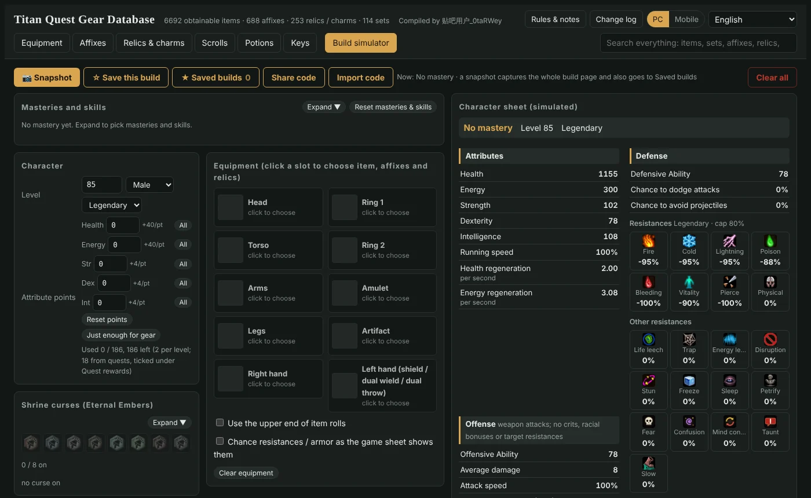

# Titan Quest Gear Database

**A free, fan-made gear finder and build planner for _Titan Quest Anniversary Edition_ (all expansions, up to Eternal Embers).**

### ▶ Open it: **https://0tarwey.github.io/tq/**

It runs in the browser. There's nothing to install and no account to make. The front page opens in your browser's language.

**[English](https://0tarwey.github.io/tq/en.html)** · [Deutsch](https://0tarwey.github.io/tq/de.html) · [Français](https://0tarwey.github.io/tq/fr.html) · [Español](https://0tarwey.github.io/tq/es.html) · [Italiano](https://0tarwey.github.io/tq/it.html) · [Português (Brasil)](https://0tarwey.github.io/tq/br.html) · [Polski](https://0tarwey.github.io/tq/pl.html) · [Čeština](https://0tarwey.github.io/tq/cz.html) · [Русский](https://0tarwey.github.io/tq/ru.html) · [Українська](https://0tarwey.github.io/tq/uk.html) · [日本語](https://0tarwey.github.io/tq/ja.html) · [한국어](https://0tarwey.github.io/tq/ko.html) · [中文](https://0tarwey.github.io/tq/index.html)

---

## What you can do with it

### Find the gear that fits your build
Pick the stats you care about, such as attack speed, a damage type, a resistance or a skill bonus. Give each one a weight and an optional minimum. The site then ranks every obtainable item for you:
- weapons, armor and jewelry;
- sets;
- relics and charms;
- scrolls, potions and keys.

Stats are grouped the way a hit actually plays out (wind-up → hit check → base damage → bonuses → defenses …), so related stats are easy to find.

Each item page shows:
- its base stats and the range each value can roll in;
- which prefixes and suffixes it can roll at each difficulty, and which combinations can actually occur;
- the best combination for the stats you picked.

### See where an item drops, and how often
Every item lists where you can get it, most likely first:
- monsters and heroes;
- chests, with each boss's chest named;
- quest rewards;
- merchants, including the electrum merchants' orbs.

Each source shows the chance per kill or per opening and where it is found. A boss's **first kill** chest and **repeat kill** chest are listed separately. A **"Hide one-time sources"** option leaves out first-kill chests and quest rewards, so you see only what you can farm.

### Plan a whole build
The **Build simulator** works like the in-game character sheet:
- choose masteries and skills;
- spend attribute points;
- equip items with their affixes and relics;
- turn on toggled skills, item-granted buffs and shrine curses.

The character sheet updates as you go: health, energy and energy reserved, offensive and defensive ability, resistances, attack speed and damage.

You can save builds and share them with a code. Many of the details have been checked against the game's own character sheet.

### Also
- **PC / Mobile switch.** The iOS and Android versions use different stat requirement formulas. Switch to Mobile and all requirements follow the mobile game.
- **Works offline.** On a phone, open the site and choose *Add to Home Screen*. After the first visit it opens full screen without a connection.
- **Favorites and a search box for everything**: items, sets, affixes, relics and more.

## About the languages
All item, affix, skill and stat texts come from the game's own translations. The Chinese and English pages are fully translated. On the other eleven language pages the game texts are in that language, but the site's own buttons and notes are still in English.

## Feedback
Found a wrong number, a missing drop, or a mistranslation? Please [open an issue](https://github.com/0taRWey/tq/issues) and include:
- the item or skill name;
- what the game shows (a screenshot helps a lot).

The change log is in the page (top right, **Change log**).

## Credits & disclaimer
Compiled by **贴吧用户_0taRWey** (0taRWey on Baidu Tieba).

This is an unofficial, non-commercial fan project, not affiliated with or endorsed by THQ Nordic. *Titan Quest* and all related names, texts and images are © THQ Nordic.

---

## 中文简介
**泰坦之旅装备资料库**是玩家自制、免费、非商业的工具，对应 PC 版《泰坦之旅：不朽之王》（含全部资料片）。网址：**https://0tarwey.github.io/tq/**

- **装备检索**：按属性排名装备、套装、镶嵌物、卷轴、药剂、钥匙，并查看词缀组合和数值范围。
- **掉落来源**：列出每个来源的几率，包括怪物、宝箱（首领宝箱分首次击杀和再次击杀）、任务奖励和商人；可以隐藏只能拿一次的来源。
- **模拟配装**：选专精和技能、加点、配装备，人物面板随之变化；配装可以保存，也可以用分享码分享。
- **PC / 手机开关**、可离线使用（「添加到主屏幕」），共 13 种语言。打开首页时自动进入浏览器语言对应的页面。

整理：贴吧用户_0taRWey。《泰坦之旅》版权归 THQ Nordic 所有。
